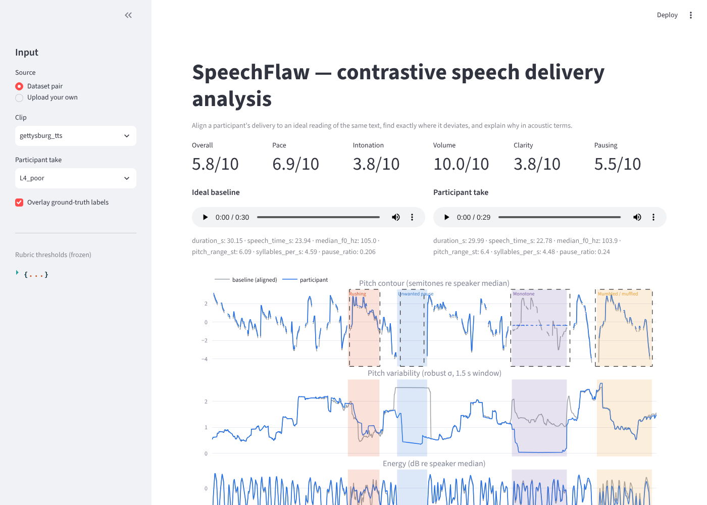

# SpeechFlaw — Contrastive Speech Analytics & Temporal Flaw Grounding

**Multimodal AI Hackathon 2026 · Track C**

SpeechFlaw compares a participant's delivery of a speech against an *ideal* delivery of the **same text**.
It aligns the two recordings in time with Dynamic Time Warping, finds the exact start/end timestamps
where the delivery deviates (rushing, dragging, monotone, trailing off, mumbling, broken or skipped pauses),
explains each deviation with the underlying acoustic numbers, and scores the take on a fixed rubric.



## What's in the repo

| Path | What it does |
|---|---|
| `speechflaw/features.py` | Speaker-normalised feature extraction on a 10 ms grid: F0 (Praat), robust pitch variability, RMS energy, spectral centroid, >2 kHz energy share, silence mask, syllable-nucleus rate, MFCCs |
| `speechflaw/compare.py` | MFCC-DTW alignment, per-frame deltas, temporal grounding of flaw regions, causal explanations, rubric scoring |
| `speechflaw/synth.py` | Builds the contrastive "bad mirror" spectrum from an ideal clip with **exact ground-truth timestamps** |
| `speechflaw/align.py` | Optional word-level forced alignment of the baseline (faster-whisper); DTW carries words onto the participant take |
| `speechflaw/evaluate.py` | Precision / recall / IoU / onset error of detected flaws vs injected labels |
| `app.py` | Streamlit dashboard: upload audio + transcript, time-series overlays, highlighted flaw regions, explanations |
| `cli.py` | `build`, `compare`, `eval` commands |
| `data/` | The contrastive dataset (ideal + 11 graded takes per clip, `labels.json`, transcript) |
| `docs/METHOD.md` | Technical documentation: dataset construction, features, rubric, scoring, limitations |
| `results/` | Evaluation output |

## Setup

Prerequisites: Python 3.10+, `ffmpeg` (for mp3/m4a input).

```bash
git clone https://github.com/nmiheer715-hue/Speech-Flaw.git
cd Speech-Flaw
python -m venv .venv && source .venv/bin/activate      # Windows: .venv\Scripts\activate
pip install -r requirements.txt
pip install faster-whisper          # optional: word labels on each flaw
```

## Run

```bash
# 1. dashboard (uses the bundled dataset, or upload your own pair)
streamlit run app.py

# 2. build a contrastive spectrum from your own ideal recording
python cli.py build --ideal clips/my_speech.wav --id my_speech --transcript clips/my_speech.txt

# 3. compare any two recordings of the same text from the command line
python cli.py compare --base data/my_speech/L0_ideal.wav --test data/my_speech/L3_noticeable.wav

# 4. reproduce the evaluation
python cli.py eval
```

## Dataset

Each clip folder in `data/` contains:

- `L0_ideal.wav` — the ideal baseline
- `L1_almost_perfect` → `L5_botched` — a graded spectrum of increasingly flawed deliveries
- `S_rush`, `S_drag`, `S_monotone`, `S_quiet`, `S_mumble`, `S_pause` — single-flaw takes that test each detector on its own
- `labels.json` — for every take, each injected flaw with its type, severity level and **exact start/end time in that take**
- `transcript.txt`

Flaws are injected by signal operators (phase-vocoder time-stretch, Praat PSOLA pitch flattening,
gain drop, low-pass "mumble", silence insertion) applied to regions snapped to natural pauses.
Since we inject them ourselves, the labels are exact. See `docs/METHOD.md`.

## Results (bundled data)

```
precision = 0.909   recall = 0.952
  Dragging           recall 1.00  IoU 0.97  onset error 0.09 s
  Monotone           recall 1.00  IoU 0.84  onset error 0.36 s
  Mumbled / muffled  recall 1.00  IoU 0.96  onset error 0.09 s
  Rushing            recall 0.80  IoU 0.84  onset error 0.22 s
  Too quiet          recall 1.00  IoU 0.65  onset error 0.36 s
  Unwanted pause     recall 1.00  IoU 0.88  onset error 0.11 s
Ideal vs itself: 0 flaws, score 10.0.  Overall score: L0 10.0 → L1 9.6 → L2 9.9 → L3 7.3 → L4 5.8 → L5 4.4
```

Full per-take table in `results/eval.txt`.

## Reproducibility

No randomness at inference: features, DTW and thresholds are deterministic, so the same pair of
files always gives the same timestamps and scores. Dataset synthesis uses fixed seeds.

## Credits

Libraries: librosa, Praat via parselmouth, SciPy, Plotly, Streamlit, faster-whisper (optional).
Speech texts used are public-domain or recorded by the author; see each clip's folder.
